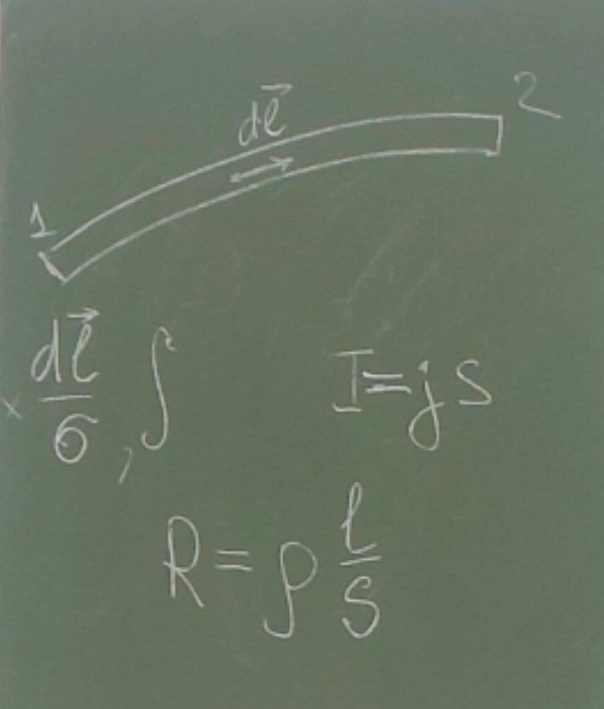
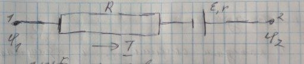
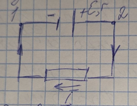
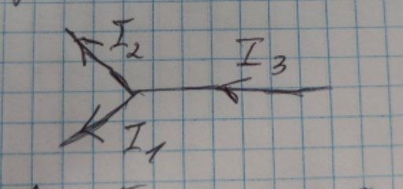
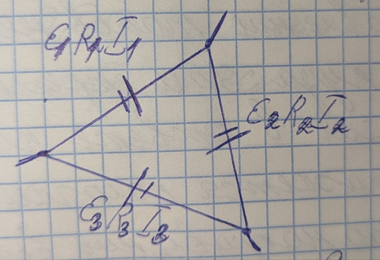

# Лекция

### Закон Ома для однородного участка цепи

$$j=\sigma(\vec{E}+\vec{E}^{*})$$

$$I=\frac{U}{R}=\frac{\phi_{1}-\phi_{2}}{R}$$

### Закон Ома для неоднородного участка цепи (в интегральной форме)

  

$$\int^{2}_{1}\frac{\vec{j}\,d\vec{l}}{\sigma}=\int^{2}_{1}\vec{E}\,d\vec{l}+\int^{2}_{1}\vec{E}^{*}\,d\vec{l}$$

Преобразуем левую часть, используя соотношение $I=jS$. В каждом сечении ток $I$ одинаков, поэтому скалярное произведение $\vec{j}\cdot d\vec{l}$ положительно, если $\vec{j}$ параллелен $d\vec{l}$, и отрицательно, если $\vec{j}$ антипараллелен $d\vec{l}$, и наоборот.

Поэтому в дальнейшем ток рассматриваем как алгебраическую величину, и тогда:

$$\int^{2}_{1}\frac{\vec{j}\,d\vec{l}}{\sigma}=\int^{2}_{1}\rho\,\vec{j}\,d\vec{l}=\int^{2}_{1}\rho\,j\,dl=\int^{2}_{1}\rho\frac{I}{S}\,dl=I\int^{2}_{1}\rho\frac{dl}{S}=I\int^{2}_{1}dR=IR$$

$$R=\rho\frac{l}{S}$$

$$IR=\phi_{1}-\phi_{2}+\varepsilon_{12}$$

  

$$I(R+r)=\phi_{1}-\phi_{2}+\varepsilon_{12}$$

$$U=\phi_{1}-\phi_{2}+\varepsilon_{12}$$

### Закон Ома для замкнутой цепи. Напряжение на зажимах источника

  

$$I=\frac{\varepsilon}{R+r}$$

$$Ir=\phi_{1}-\phi_{2}+\varepsilon$$

Если источник разомкнут, $I=0$, и тогда $\varepsilon=\phi_{2}-\phi_{1}$.

Если источник замкнут, то $\phi_{2}-\phi_{1}=\varepsilon-Ir$.

$$IR=\frac{\varepsilon R}{R+r}$$

$$\frac{\phi_{2}-\phi_{1}}{\varepsilon}=\frac{R}{R+r}=\frac{1}{1+\frac{r}{R}}$$

При $\dfrac{r}{R}\to 0$ имеем $\phi_{2}-\phi_{1}\to\varepsilon$.

### Разветвлённые цепи. Правила Кирхгофа

1-е правило Кирхгофа относится к узлам цепи.

  

Алгебраическая сумма токов, сходящихся в узле, равна 0.

$$\sum I_{k}=0$$

$$I_{3}-I_{1}-I_{2}=0$$

1-е правило Кирхгофа является следствием закона сохранения заряда.

Если в схеме $N$ узлов, то независимыми будут $N-1$ уравнений.

2-е правило Кирхгофа. Если у нас имеется произвольный замкнутый контур:

  

Алгебраическая сумма произведений сил токов в отдельных участках произвольного замкнутого контура на их сопротивления равна алгебраической сумме ЭДС, действующих в этом контуре.

$$\sum I_{i}R_{i}=\sum\varepsilon_{k}$$

### Закон Ома для всех трёх участков

$$
\begin{cases}
I_1 R_1 = \varphi_1 - \varphi_2 + \varepsilon_1 \\
I_2 R_2 = \varphi_2 - \varphi_3 + \varepsilon_2 \\
I_3 R_3 = \varphi_3 - \varphi_1 + \varepsilon_3
\end{cases}
$$

### Как надо поступать при составлении уравнений

1. Обозначить стрелками положительное направление токов, не задумываясь, куда эти стрелки направлены. Если в ответе какой-то ток окажется положительным, то его направление выбрано правильно; если же ток окажется отрицательным, то его истинное направление противоположно выбранному.

2. Выбрав произвольный замкнутый контур, все его участки следует обойти в одном направлении, например по часовой стрелке. Если предполагаемое направление некоторого тока совпадает с выбранным направлением обхода, то $IR$ берётся со знаком плюс, если не совпадает — то минус. Аналогично и ЭДС: она тоже берётся алгебраически.
