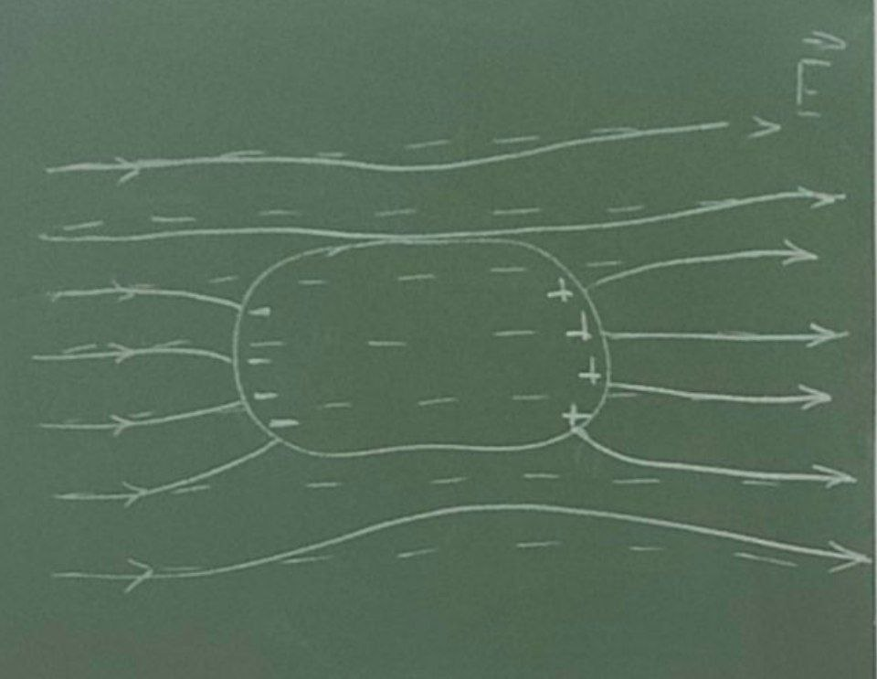
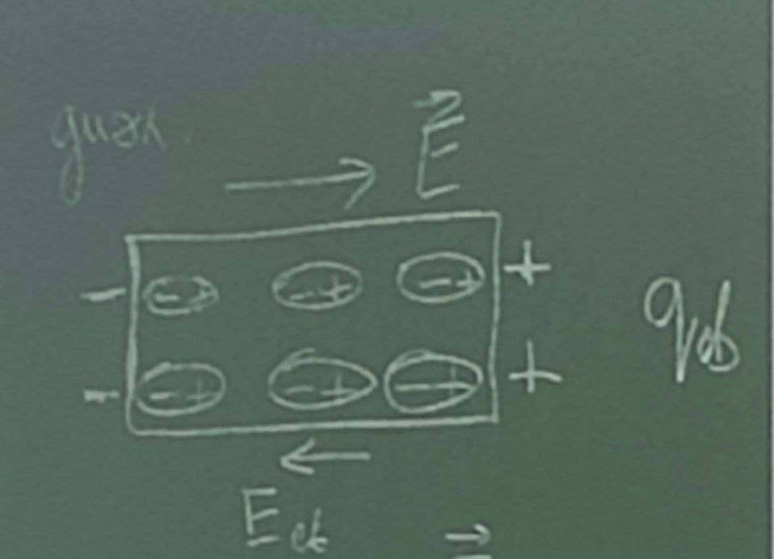
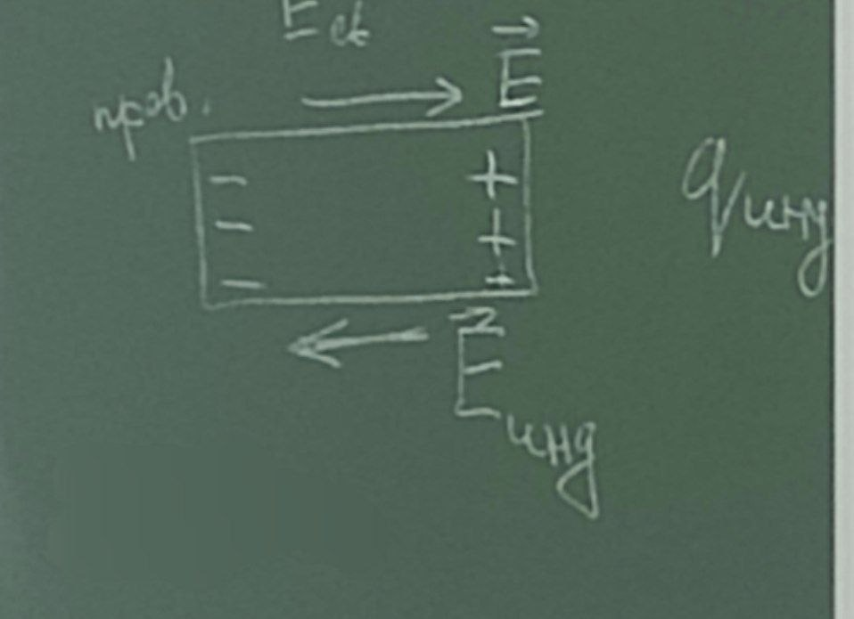
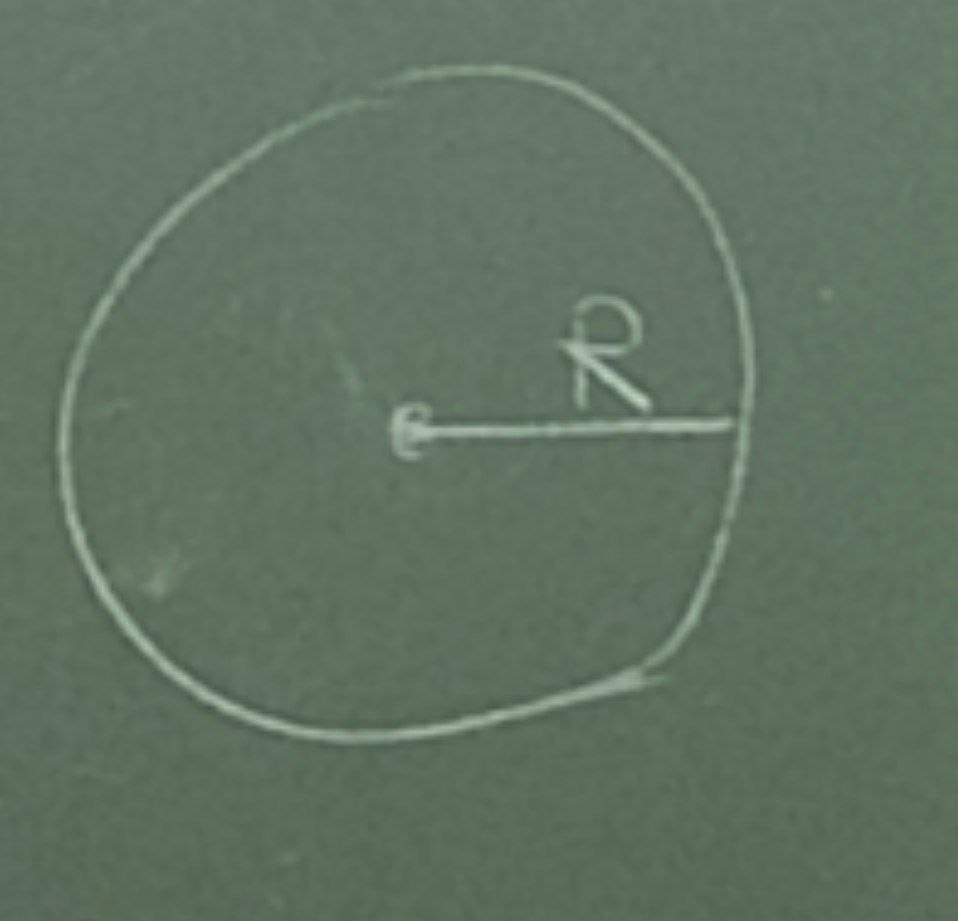
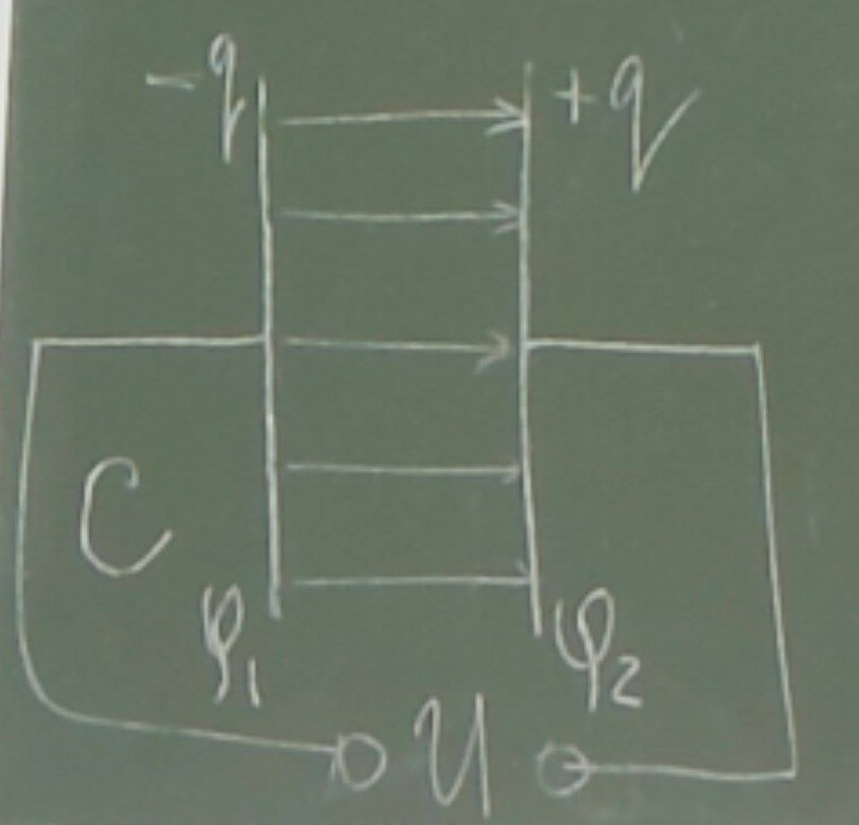

# Лекция

### Теорема Остроградского–Гаусса для электрического поля в диэлектрике

Формулы

$$\vec{P}=\frac{1}{\Delta V}\sum_{\Delta V}\vec{p}$$

Можно доказать, что $\Phi_{p}$, который определяется как $\oint \vec{P}\,d\vec{S}$:

$$\Phi_{p}=\oint \vec{P}\,d\vec{S}=-\sum q_{\text{связ}}$$

Связанные заряды отличаются от свободных только тем, что они не могут покинуть пределы молекул, и все их остальные свойства такие же.

$$\Phi_{E}=\oint_{S}\vec{E}\,d\vec{S}=\frac{1}{\varepsilon_{0}}\left(\sum q+\sum q_{\text{связ}}\right)$$

$$\varepsilon_{0}\Phi_{E}+\Phi_{P}=\oint(\varepsilon_{0}\vec{E}+\vec{P})\,d\vec{S}=\sum q=\int_{V}\rho\,dV$$

$$\vec{D}=\varepsilon_{0}\vec{E}+\vec{P}\quad-\quad\text{вектор электрического смещения}$$

$$\Phi_{D}=\oint \vec{D}\,d\vec{S}=\sum q=\int_{V}\rho\,dV$$

Поток вектора электрического смещения через замкнутую поверхность равен алгебраической сумме заключенных внутри этой поверхности сторонних зарядов.

$\vec{P}=0$ — в вакууме.

$$\vec{D}=\varepsilon_{0}\vec{E}$$

Запишем $D$ иначе:

так как $\vec{P}=\ae\varepsilon_{0}\vec{E}$ и

$$\vec{D}=\varepsilon_{0}\vec{E}+\ae\varepsilon_{0}\vec{E}=\varepsilon_{0}(1+\ae)\vec{E}=\varepsilon_{0}\varepsilon\vec{E}$$

$$\varepsilon=1+\ae$$

относительная диэлектрическая проницаемость среды.

Вещество: $\vec{D}=\varepsilon_{0}\varepsilon\vec{E}$ — с ограничениями.

$\vec{E}$ и $\vec{D}$ — неколлинеарные.

Общее соотношение:

$$\vec{D}=\varepsilon_{0}\vec{E}+\vec{P}$$

без ограничений.

### Проводники в электрическом поле

Вещества, содержащие свободные заряженные микрочастицы (носители зарядов), называются проводниками.

Ими являются:
- металлы
- плазма
- электролитическая жидкость

Носители заряда в проводнике способны перемещаться под действием сколь угодно малой силы, потому для равновесия зарядов в проводнике необходимо выполнить следующих условий.

Условия равновесия зарядов в проводнике:

1) напряженность поля всюду внутри проводника должна равняться 0. Это означает, что потенциал внутри проводника должен быть постоянным $\phi=\mathrm{const}$;
2) напряженность поля на поверхности проводника должна быть в каждой точке направлена по нормали поверхности, это означает $E=E_{n}$;
3) поле внутри проводника, если проводнику сообщить заряд $q$, он распределится так, чтобы соблюдались условия равновесия.

Внутри проводника не может быть избыточных зарядов.

Избыточный заряд распределяется на полом проводнике так же, как и на сплошном, то есть по его наружной поверхности.

Плотность зарядов при данном потенциале проводника определяется кривизной поверхности, она растет с увеличением положительной кривизны (выпуклости) и убывает с увеличением отрицательной кривизны (вогнутости). Особенно велика плотность зарядов на остриях и может происходить истечение заряда с острия.

$$E=\frac{\sigma}{\varepsilon_{0}\varepsilon}$$

### Проводник во внешнем электрическом поле

  

При внесении незаряженного проводника в электрическое поле носители зарядов приходят в движение, "+" по линиям напряженности и "-" против линии напряженности, возникают индуцированные заряды, и перераспределение происходит до тех пор, пока не будут выполняться условия равновесия.

Условия равновесия:
- напряженность поля внутри проводника должна быть равна 0;
- напряженность поля на поверхности должна быть в каждой точке направлена по нормали.

Таким образом, нейтральный проводник, внесенный в поле, разрывает часть линий напряженности, они заканчиваются на отрицательно индуцированных зарядах и вновь начинаются на положительных.

  

$$\vec{E}=\vec{E}_{0}+\vec{E}_{\text{связ}}$$

$$E=E_{0}-E_{\text{связ}}$$

$$E=\frac{E_{0}}{\varepsilon}$$

  

$$\vec{E}=\vec{E}_{0}+\vec{E}_{\text{инд}}$$

$$E=E_{0}-E_{\text{инд}}=0$$

### Электроемкость уединенного проводника

Поле, напряженность и потенциал в каждой точке увеличивается в определенное количество раз заряда, приводит к увеличению в то же число раз поверхности и плотности заряда $\sigma$, а значит значение $E$ и $\phi$ в каждой точке окружающей проводник.

$$q=C\phi$$

$C$ — электроемкость или емкость проводника.

Пример:
Вычислим емкость заряженного шара радиусом $R$.

  

$$\phi=k\frac{q}{\varepsilon R}$$

$$C=\frac{\varepsilon R}{k}=4\pi\varepsilon_{0}\varepsilon R$$

$$1\,\text{Ф}=\frac{1\,\text{Кл}}{1\,\text{В}}$$

Взаимная емкость двух проводника в конденсаторах — это устройство, в котором при небольшом относительно окружающих тел потенциале накапливает, то есть конденсирует заметные по величине заряды.

В основе лежит тот факт, что электроемкость проводника возрастает при приближении к нему других тел. Это вызвано тем, что под действием поля, создаваемого проводником, на поднесенном к нему теле возникают индуцированные на проводнике или связанные на диэлектрике заряды. Заряды противоположного знака расположены ближе и оказывают большее влияние на его потенциал. Потенциал уменьшается, а это означает увеличение емкости.

  

$$C=\frac{q}{\phi_{1}-\phi_{2}}=\frac{q}{U}$$

Емкость определяется геометрией, формами и размерами охвата и зазорами между ними и свойствами окружающей среды $\varepsilon$.

Пример:

$$E=\frac{\sigma}{\varepsilon_{0}\varepsilon}=\frac{q}{\varepsilon_{0}\varepsilon S}$$

$$\phi_{1}-\phi_{2}=Ed=\frac{qd}{\varepsilon_{0}\varepsilon S}$$

$$C=\frac{\varepsilon_{0}\varepsilon S}{d}$$

$$U_{\max}$$

### Энергия заряженного проводника

$$w=\frac{q\phi}{2}=\frac{q^{2}}{2C}=\frac{C\phi^{2}}{2}$$

находится как потенциальная энергия взаимодействия зарядов, находящихся на проводнике.

### Энергия заряженного конденсатора

Рисунок с пластинами второй наоборот (потерял, но всё равно почти то же самое).

  

$$w=\frac{1}{2}(q\phi_{1}-q\phi_{2})=\frac{1}{2}q(\phi_{1}-\phi_{2})=\frac{1}{2}qU$$

$$w=\frac{qU}{2}=\frac{q^{2}}{2C}=\frac{CU^{2}}{2}$$

### Энергия электрического поля, объемная плотность энергии

Вычислим энергию плоского конденсатора через величины, характеризующие поле:

$$w=\frac{CU^{2}}{2}=\frac{\varepsilon_{0}\varepsilon S}{2d}U^{2}=\frac{\varepsilon_{0}\varepsilon}{2}\left(\frac{U}{d}\right)^{2}Sd$$

$$\frac{U}{d}=E$$

$$Sd=V$$

$$w=\frac{\varepsilon_{0}\varepsilon E^{2}V}{2}$$

$$\omega=\frac{w}{V}$$

$$\omega=\frac{\varepsilon_{0}\varepsilon E^{2}}{2}=\frac{ED}{2}$$

В изотропных диэлектриках $E$ и $D$ совпадают, и поэтому

$$\omega=\frac{\vec{E}\cdot\vec{D}}{2}$$

$$\omega=\frac{\varepsilon_{0}E^{2}}{2}+\frac{\vec{E}\cdot\vec{P}}{2}$$

$\dfrac{\varepsilon_{0}E^{2}}{2}$ — плотность энергии электростатического поля в вакууме.

$\dfrac{\vec{E}\cdot\vec{P}}{2}$ — энергия, затрачиваемая на поляризацию диэлектрика.
