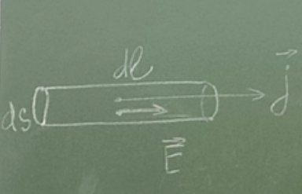
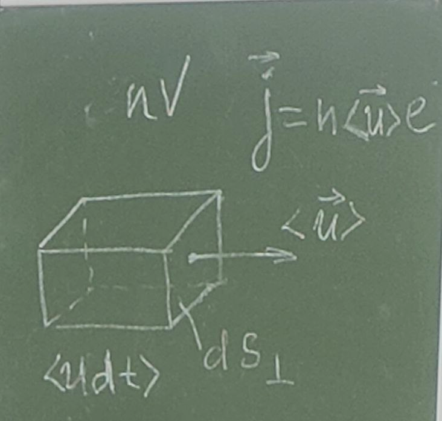

  

> Это я, когда проснулся и осознал, что нужно дописать лекцию.

# Лекция

### Закон Джоуля–Ленца

Рассмотрим произвольный участок постоянного тока цепи, к концам которого приложено напряжение $U$. За время $t$ через каждое сечение проводника проходит заряд $q=It$.

Это равносильно тому, что заряд $It$ переносится из одного конца проводника в другой.

При этом силы электростатического поля и сторонние силы, действующие на электроны, совершают работу $A=Uq=UIt$.

В случае, если в проводнике не совершается механическая работа и химических превращений в нём не происходит, эта работа целиком затрачивается на увеличение внутренней энергии проводника, в результате чего он нагревается.

Говорят, что при протекании тока в проводнике выделяется тепло:

$$Q=UIt=I^{2}Rt\quad-\quad\text{закон Джоуля–Ленца}$$

Найдем локальную форму закона Джоуля–Ленца

  

$$R=\rho\frac{l}{S}$$

$$j=\frac{I}{S}$$

Выделим элементарный объём в виде цилиндра длиной $dl$ и площадью сечения $dS$. За время $dt$ в этом объёме выделится тепло:

$$dQ=I^{2}R\,dt=\rho\frac{dl}{dS}(j\,dS)^{2}\,dt=\rho j^{2}\,dV\,dt$$

$P_{\text{уд}}$ — удельная тепловая мощность тока

$$P_{\text{уд}}=\frac{dQ}{dV\,dt}=\rho j^{2}$$

равна произведению удельного сопротивления среды на квадрат плотности тока в данной точке.

Это наиболее общая формула закона Джоуля–Ленца, она применима к любым проводникам, независимо от природы сил, возбуждающих ток.

Если на носители тока действует только электрические силы, то

$$\vec{j}=\sigma\vec{E}$$

$$j=\frac{1}{\rho}\vec{E}$$

$$P_{\text{уд}}=\frac{1}{\rho}E^{2}=\sigma E^{2}$$

### Элементарная классическая теория электропроводности металлов

#### Основные представления

На рубеже 19–20 веков, с помощью опытов было доказано, что носителями тока в металлах являются свободные электроны (электроны открыты Томсоном в 1897 году).

Ток в металлах можно вызвать крайне малой разностью потенциалов, это основание даёт считать, что электроны перемещаются по металлу практически свободно.

Фактически электроны создают газ из валентных электронов. Если отщепляется по одному электрону, то число $n$ электронов единицы объёма равно числу атомов $n_{\text{а}}$.

По порядку величины $n=10^{28}{-}10^{29}\,\text{м}^{-3}$.

Электроны до столкновения с ионами (они между собой не сталкиваются, сталкиваются с ионами) двигаются совершенно свободно, поэтому средняя длина свободного пробега $\lambda$ — имеет порядок, определяемый периодом кристаллической решётки металла.

Расчёт средней скорости хаотичного движения при комнатной температуре:

$$\lambda\approx 10^{-10}\,\text{м}$$

$$\langle v\rangle=10^{5}\,\text{м/с}=\sqrt{\frac{8kT}{\pi m}}$$

При включении поля на хаотическое тепловое движение накладывается упорядоченное движение электрических зарядов со средней скоростью $\langle\vec{u}\rangle$

  

За время $dt$ через площадку $dS_{\perp}$ пройдут $n\cdot dV$ электронов, которые перенесут заряд $dq=nVe$. Таким образом для плотности тока получается

$$j=\frac{dq}{dt\,dS_{\perp}}=\frac{nVe}{dt\,dS_{\perp}}=\frac{n\langle u\rangle\,dt\,dS_{\perp}\,e}{dt\,dS_{\perp}}$$

$$\vec{j}=n\langle\vec{u}\rangle e$$

Оценим $\langle u\rangle$.

Предельно допустимыми техническими нормами плотность тока для медных проводов составляет около $10\,\text{А/мм}^{2}$.

$$\frac{10\,\text{А}}{\text{мм}^{2}}=10^{7}\,\frac{\text{А}}{\text{м}^{2}}$$

взяв $n=10^{29}\,\text{м}^{-3}$ получим:

$$\langle u\rangle=\frac{j}{ne}=10^{-3}\,\text{м/с}$$

То есть даже при очень больших плотностях средняя скорость упорядоченного движения зарядов $u$ в $10^{8}$ раз меньше скорости хаотического движения.

Время установления тока в цепи:

$$t=\frac{l}{c}$$

Время распространения (почти мгновенно).

Таким образом упорядоченное движение возникает одновременно на всём протяжении проводника при замыкании цепи.

### Закон Ома в рамках классической теории электропроводности металлов

Классическая теория создана Друде и усовершенствована Лоренцом. Друде считал, что сразу после столкновения с ионом кристаллической решётки $\langle u\rangle_{t}=0$.

Поэтому скорость электронов меняется от $0$ до $\langle u\rangle_{t\,\max}$:

$$\langle u\rangle_{t\,\max}=a\tau=\frac{eE}{m}\tau$$

где $\tau$ — среднее время между 2 последовательными соударениями электрона.

Распределение молекул по скоростям хаотического движения не учитывается.

считают, что все электроны имеют одинаковую скорость $v$.

В этом приближении

$$\tau=\frac{\lambda}{\langle v\rangle}$$

За время $\tau$ электрон приобретает скорость $\langle u\rangle_{\max}=a\tau=\dfrac{eE}{2m}\tau$. Средняя скорость упорядоченного движения:

$$\langle u\rangle=\frac{1}{2}\langle u\rangle_{\max}=\frac{eE}{2m}\tau$$

учтем $j=n\langle u\rangle e$ соотношение и тогда $j=n\langle u_{z}\rangle e$

$$j=\frac{ne^{2}\lambda}{2m\langle v\rangle}E$$

сравним с законом Ома

$$j=\sigma E$$

сравниваем и получаем

$$\sigma=\frac{ne^{2}\lambda}{2m\langle v\rangle}$$

В рамках полученного закона $\rho$ пропорциональна $1/\sigma$ и пропорциональна корню из абсолютной температуры.

На самом деле $\rho$ пропорциональна температуре.

Если бы электроны не сталкивались с ионами решётки, длина свободного пробега и проводимость были бы бесконечно велики.

Таким образом электрическое сопротивление металлов обусловлено соударениями свободных $e^{-}$ с ионами кристаллической решётки.

### Закон Джоуля–Ленца

$$Q=I^{2}Rt$$

Согласно классической теории, к концу свободного пробега $e^{-}$ приобретает дополнительную кинетическую энергию. Столкнувшись с ионом, $e^{-}$ полностью теряет скорость, то есть передаёт энергию кристаллической решётке.

Эта энергия идёт на увеличение внутренней энергии металла, то есть на нагревание. Таким образом нагревание проводника происходит за счёт работы, совершаемой силами поля над носителями заряда.

$$\langle\Delta E_{\text{кин}}\rangle=\frac{m\langle v\rangle_{\max}^{2}}{2}=\frac{e^{2}\lambda^{2}E^{2}}{2m\langle v\rangle^{2}}$$

Каждый $e^{-}$ претерпевает за секунду в среднем $\dfrac{1}{\tau}=\dfrac{\langle v\rangle}{\lambda}$ соударений, сообщая каждый раз решётке энергию, следовательно единица объёма за единицу времени должна выделять тепло:

$$P_{\text{уд}}=n\frac{1}{\tau}\langle\Delta E_{\text{кин}}\rangle=\frac{ne^{2}\lambda}{2m\langle v\rangle_{T}}E^{2}=\sigma E^{2}$$
