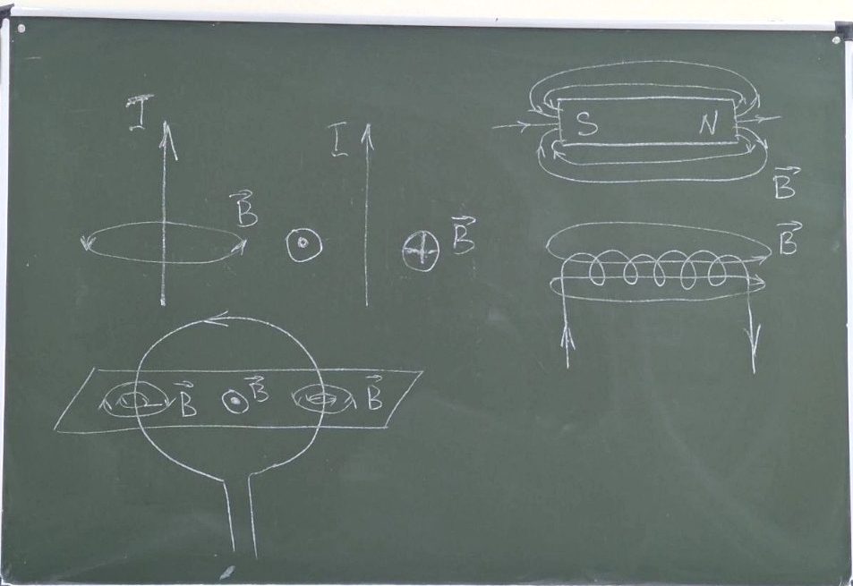
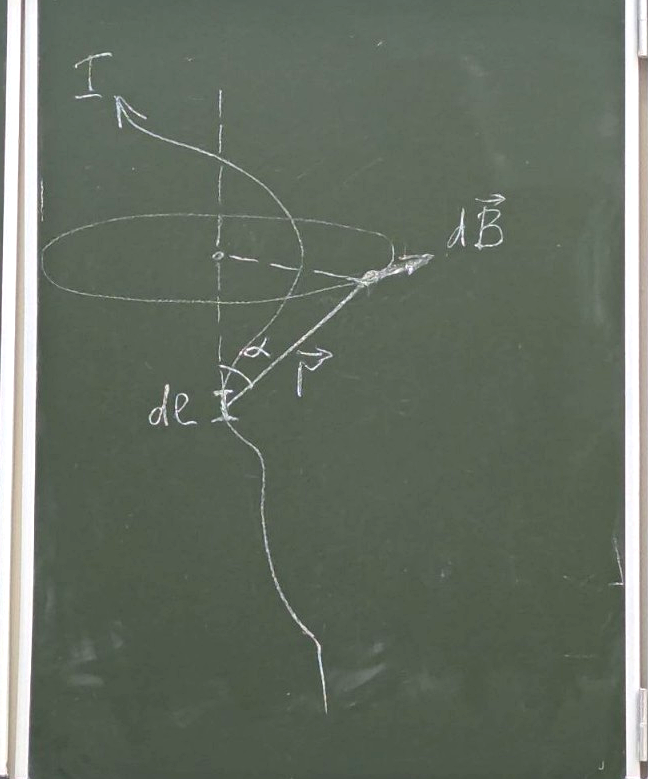
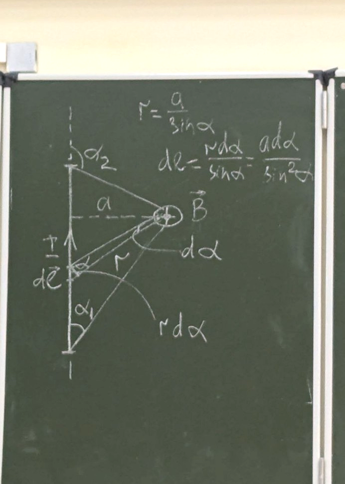
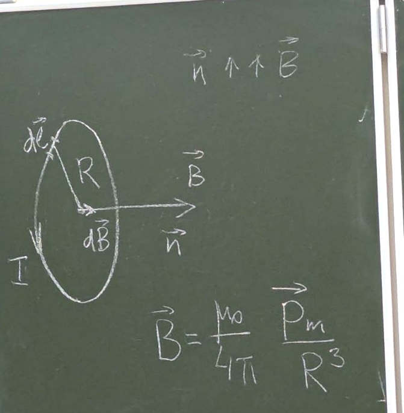
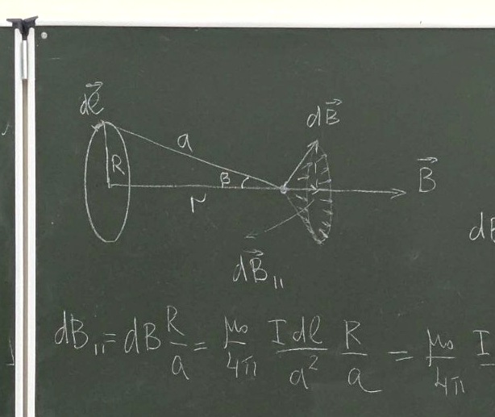

  

# Лекция
### Магнитное поле в вакууме. Взаимодействие токов

Вокруг проводников с током и постоянных магнитов существует магнитное поле, которое обнаруживается по силовому действию, оказываемому на другие проводники с током или постоянные магниты.

#### Гипотеза Ампера

Железо напитано электрическими токами в атомном масштабе.

Итак, движущиеся заряды (токи) изменяют свойства окружающего их пространства, создают в нём магнитное поле.

Это поле проявляется тем, что на движущиеся в нём заряды (токи) действуют силы.

Таким образом, посредством магнитного поля токи взаимодействуют между собой.

Сила взаимодействия, приходящаяся на единицу длины любого из проводов, пропорциональна их токам и обратно пропорциональна расстоянию:

$$F=2k\frac{I_{1}I_{2}}{b}$$

### Вектор магнитной индукции

Из опыта следует, что магнитное поле имеет направленный характер и должно характеризоваться некоторой векторной величиной.

$$\vec{B}\quad-\quad\text{вектор магнитной индукции}$$

Магнитное поле порождается только движущимися зарядами.

Для магнитного поля справедлив принцип суперпозиции:

$$\vec{B}=\sum_{i}\vec{B}_{i}$$

Для исследования поля используются либо магнитная стрелка, либо маленький ток, циркулирующий в плоском замкнутом контуре.

Поле ориентирует контур так, чтобы направление нормали $\vec{n}$ совпадало с направлением поля $\vec{B}$.

Если $\vec{B}$ не параллелен $\vec{n}$, возникает вращающий момент, стремящийся повернуть контур.

Его величина зависит от угла между $\vec{n}$ и $\vec{B}$: достигает максимума при $\alpha=90^{\circ}$ (когда они перпендикулярны) и обращается в нуль, когда они параллельны.

Вращающий момент зависит как от свойств поля, так и от свойств контура.

$$N_{\max}\sim I,\,S$$

Для характеристики контура берём величину — магнитный момент:

$$\vec{p}_{m}=IS\vec{n}$$

Отношение максимального момента к магнитному моменту пропорционально $\vec{B}$:

$$\frac{\vec{N}_{\max}}{p_{m}}\sim\vec{B}$$

$\vec{B}$ измеряется в теслах $[Тл]$.

### Правило буравчика

Если ввинчивать буравчик по направлению тока, то направление движения рукоятки укажет направление линий индукции.

  

### Свойства

Линии магнитной индукции не могут обрываться ни в каких точках поля; они либо замкнуты, либо идут в $\infty$ и с $\infty$.

Северный полюс магнита соответствует тому концу соленоида (или контура), из которого выходят линии индукции.

В отличие от электрических зарядов, магнитных монополей не существует, поэтому линии индукции $\vec{B}$ не обрываются на полюсах.

### Закон Био–Савара–Лапласа

  

$$d\vec{B}=\frac{\mu_{0}}{4\pi}\frac{I[d\vec{l},\vec{r}]}{r^{3}}$$

$$\mu_{0}=4\pi\cdot 10^{-7}\,\frac{\text{Гн}}{\text{м}}$$

Вектор $d\vec{B}$ направлен перпендикулярно плоскости, проходящей через $d\vec{l}$ и точку, в которой вычисляется поле, причём направление $d\vec{B}$ связано с $d\vec{l}$ правилом правого винта.

$$dB=\frac{\mu_{0}}{4\pi}\cdot\frac{I\,dl}{r^{2}}\sin\alpha$$

где $\alpha$ — угол между векторами $d\vec{l}$ и $\vec{r}$.

### Магнитное поле прямолинейного проводника с током

  

$$r=\frac{a}{\sin\alpha}$$

$$dl=\frac{r\,d\alpha}{\sin\alpha}=\frac{a\,d\alpha}{\sin^{2}\alpha}$$

Рассмотрим произвольный элемент $d\vec{l}$. Все векторы $d\vec{B}$ в рассмотренной точке имеют одинаковое направление ($\otimes$ — крестик). Поэтому сложение векторов $d\vec{B}$ заменяем сложением их модулей.

Подставляя закон Био–Савара–Лапласа, имеем:

$$dB=\frac{\mu_{0}}{4\pi}\cdot\frac{I\cdot a\,d\alpha\cdot\sin\alpha}{a^{2}\cdot\sin^{2}\alpha}=\frac{\mu_{0}}{4\pi}\cdot\frac{I}{a}\sin\alpha\,d\alpha$$

При интегрировании от $\alpha_{1}$ до $\alpha_{2}$ получаем:

$$B=\int dB=\frac{\mu_{0}}{4\pi}\cdot\frac{I}{a}\int_{\alpha_{1}}^{\alpha_{2}}\sin\alpha\,d\alpha=\frac{\mu_{0}}{4\pi}\cdot\frac{I}{a}(\cos\alpha_{1}-\cos\alpha_{2})$$

Прямой бесконечно длинный ток: в пределе $\alpha_{1}=0$, $\alpha_{2}=\pi$ ($180^{\circ}$), поэтому

$$B=\frac{\mu_{0}I}{2\pi a}$$

Линии магнитной индукции — система концентрических окружностей.

### Магнитное поле кругового тока. Магнитный диполь

  

По закону Био–Савара–Лапласа в центре витка ($\alpha=90^{\circ}$, $\sin\alpha=1$):

$$dB=\frac{\mu_{0}}{4\pi}\cdot\frac{I\,dl}{R^{2}}$$

$$B=\int dB=\frac{\mu_{0}}{4\pi}\cdot\frac{I}{R^{2}}\oint dl=\frac{\mu_{0}}{4\pi}\cdot\frac{I}{R^{2}}\cdot 2\pi R$$

$$B=\frac{\mu_{0}I}{2R}$$

$$p_{m}=IS=I\pi R^{2}$$

$$B=\frac{\mu_{0}}{4\pi}\cdot\frac{2p_{m}}{R^{3}}=\frac{\mu_{0}I}{2R}$$

$$\vec{B}=\frac{\mu_{0}}{4\pi}\cdot\frac{2\vec{p}_{m}}{R^{3}}$$

### Магнитная индукция на оси кругового тока

  

Из соображений симметрии можно заключить, что результирующий вектор $\vec{B}$ направлен вдоль оси витка (перпендикулярные к оси составляющие $d\vec{B}$ взаимно уничтожаются).

Поэтому суммирование векторов $d\vec{B}$ заменяем суммированием их проекций на ось:

$$dB_{\parallel}=dB\sin\beta=dB\frac{R}{a}=\frac{\mu_{0}}{4\pi}\frac{I\,dl}{a^{2}}\cdot\frac{R}{a}=\frac{\mu_{0}}{4\pi}\frac{IR\,dl}{a^{3}}$$

$$a=\sqrt{R^{2}+r^{2}}$$

$$B=\frac{\mu_{0}IR^{2}}{2(R^{2}+r^{2})^{3/2}}$$

> На этом всё.

  

