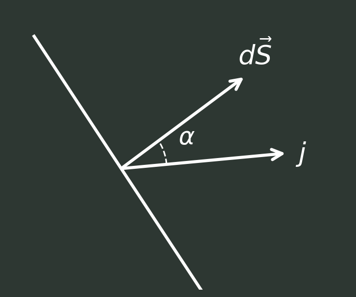
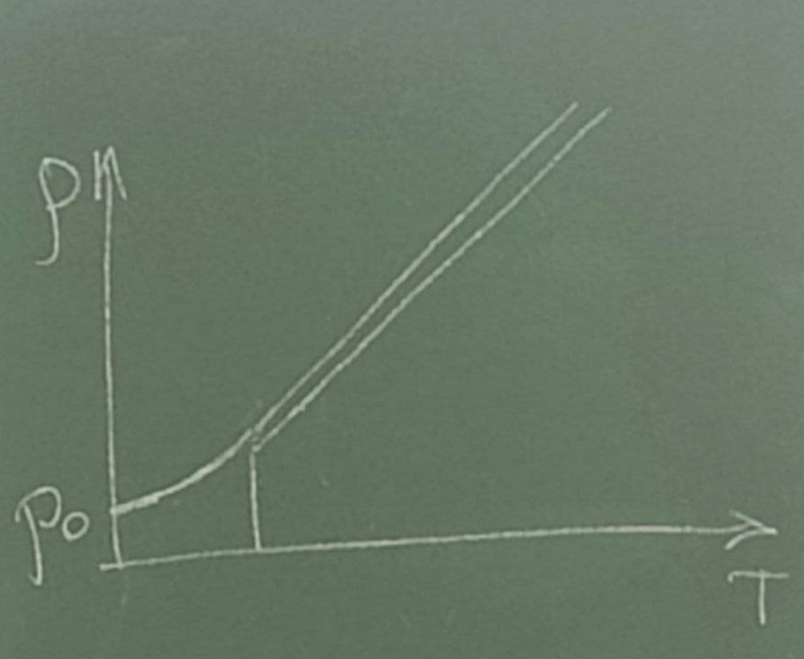
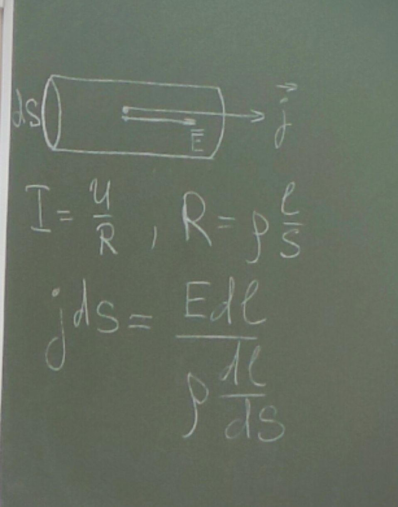
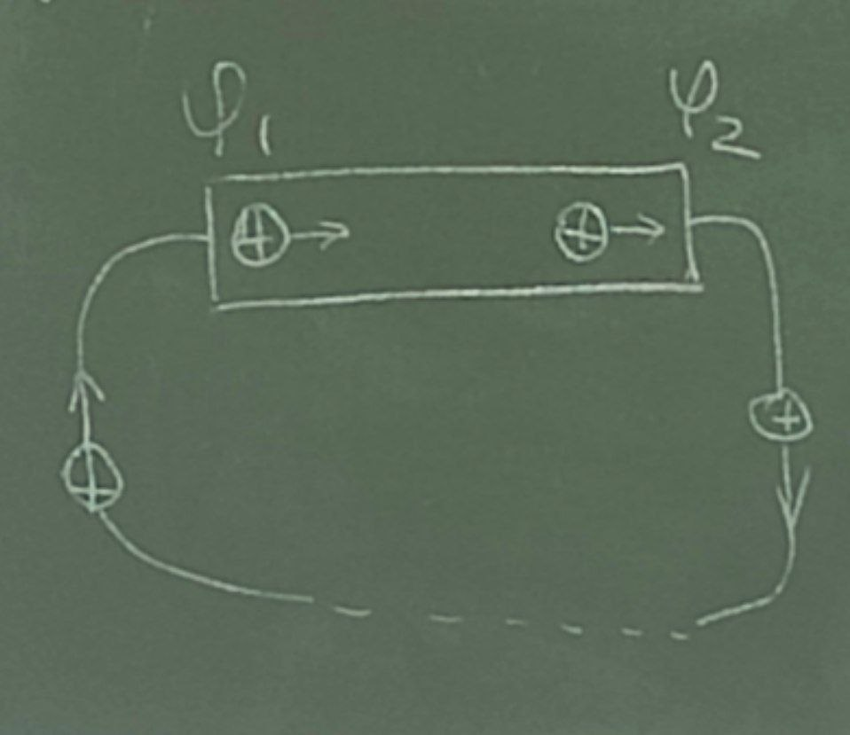
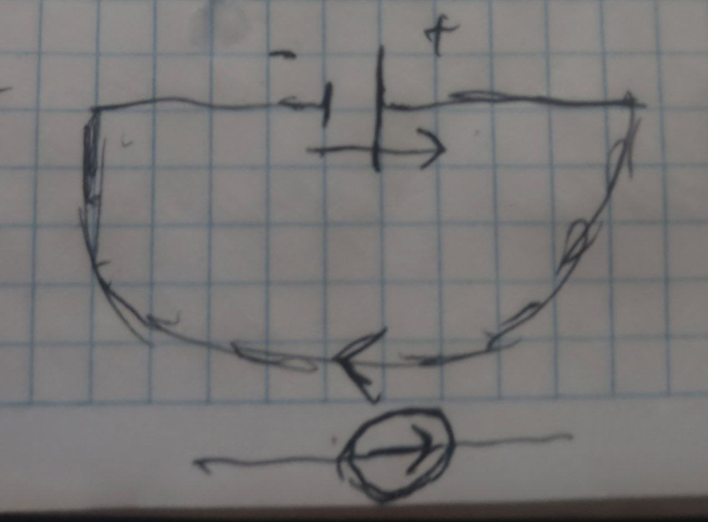

# Лекция

## Постоянный электрический ток

Электрическим током называется упорядоченное движение электрических зарядов. Упорядоченное движение электрических зарядов в проводнике называется током проводимости(ток в металлах, электролитах, газах).

За направление тока условно принимают управление движения положительных зарядов.

При движении зарядов нарушается их равновесное распределение, поверхность проводника уже не является потенциальной. Электрические силовые линии не перпендикулярны к ней, поскольку для движения зарядов необходимо чтобы e с индексом тау, на поверхности проводника было не равна нулю, внутри проводника должно существовать электрическое поле, так как его нет только в случае равновесного распределения зарядов по поверхности.

Условия возникновения и существования тока:

1) Наличие в среде носителя заряда, которые можно перемещать по проводнику
2) Наличие в среде электрического поля не электрического прохождения, энергия которого затрачивалась бы на перемещение зарядов, чтобы ток не прекращался, энергия должна пополняться

## Сила и плотность тока

Силой тока I называется физическая величина равная отношению заряда dq переносимого через поверхность S, за малый промежуток времени dt

$$
I = \frac{dq}{dt}
$$

чтобы ток был постоянным, заряды не должны накапливаться или убывать не в одной части проводника, поэтому цепь должна быть замкнутой, а суммарный заряд который поступает за одну секунду сквозь сечение S1 должен быть равен суммарному заряду, выходящего из этого объема через сечение S2. Следовательно сила постоянного тока одинакова во всех сечения проводника.

Единицей силы тока является Ампер,

$$
1 А = \frac{1Кл}{1 сек} 
$$

распределение тока по сечению характеризуется вектором плотностью тока ёт.

$$\vec{j}=\frac{dI}{dS_{⊥}}$$

вектор ёт совпадает по направлению с движением положительных заряженных частиц, и численно равен отношению силы тока dI сквозь малый элемент поверхности, нормальной направлению движению частиц площади dS⊥ этого элемента.

Измеряется в А/м2 .

Поле вектора плотности тока можно изобразить с помощью линий тока, зная вектор плотности тока ёт, каждой точки пространства, можно найти силу тока через любую поверхность S

$$
dI=\vec{j}\cdot d\vec{S_{⊥}}=j \cos\alpha =j\,dS\cos\alpha = j_{n}\,dS\cos\alpha = (j_{n}\,dS) = \vec{j}\cdot d\vec{S}
$$

$$
I=\int_S \vec{j}\cdot d\vec{S} = \int_S \vec{j_n}\,d \vec{S}
$$

Плотность тока одинакова по всему поперечному сечению S однородного проводника и поэтому для него справедливо соотношение.

$$
I= j_{n}S
$$

$$\oint_S jdS = - \frac{dq}{dt} - уравнение\ непрерывности$$

Оно является выражением законом сохранения электрического заряда.

В случае постоянного тока распределение зарядов в пространстве должно оставаться не именным, то есть dq/dt = 0, следовательно для постоянно тока

$$\oint_S jdS = 0$$

То есть линии плотности тока j(ёт) не где не начинаются и ни где не заканчиваются.

Мы говорим что в случае постоянного тока, поле вектора j(ёт) не имеет источников.

## Закон Ома для однородного проводника

Сила тока протекающая по однородному проводнику пропорционально разности потенциалов(напряжению), на его концах.

$$I = \frac{U}{R}  \ \ \ \ \ \ \ \ \ \ \ \ \ \ \ \ \ \ \ \ \ \ \  R - сопротивление \ проводника(Ом)$$

Величина R зависит от формы и размеров проводника, а так же от свойств материала из которых он изготовлен(и от температуры). Для однородного цилиндрического проводника есть формула:

$$R = ρ \frac{l}{S}$$

l(эль) - длинна провода

S - поперечное сечение

ρ(ро) - удельное сопротивление проводника

ρ(ро) зависит от материала проводника и его температуры, для большинства металлов зависимость такая:

$$ρ = ρ_{o} \alpha T$$

[ρ(ро)] - [Ом * м]

## Закон Ома в дифференциальной форме

$$\sigma = \frac{1}{ρ}$$

$$j=\frac{1}{ρ}E = \sigma\vec{E} \ \ - \ \ 2 \ закон \ Ома$$

$$I = \frac{U}{R} \ \ - \ \ 1 \ закон \ Ома$$

## Сторонние силы

Чтобы поддерживать ток достаточно длительное время, нужно от конца проводника с меньшим потенциалом непрерывно отводить приносимые сюда током заряды, а к концу с большим потенциалом непрерывно их подводить.

то есть должны быть участки где положительные носители движутся в сторону возрастания потенциала. То есть против сил электростатического поля.

Перемещение носителей на этих участках, возможно лишь с помощью сил не электростатического происхождения называемыми сторонними силами. Таким образом для  поддержания тока необходимы сторонние силы, действующие либо на всем протяжении линии цепи, либо на отдельных ее участках. физическая природа  может быть различна(гальванические элементы, аккумуляторы, термоэлементы и так далее).

Для количественной характеристики сторонних сил вводят понятие поле сторонних сил его характеризуют либо вектором Е*, либо работой сторонних сил А. Вектор напряженности поля Е* численно равен сторонней силе действующей на 1 положительный заряд.

$$\vec{F_{ст}} = E^*q$$

Величина равная работе сторонних сил над единичным положительным зарядом называется эдс ε

$$ε = \frac{A}{q}$$

размерность эдс Вольты, связь между ними находится из следующего соотношения:

$$A_{12} = \int_{2}^1\vec{F_{ст}d \vec{l}} = q \int^2_{1} E^*dl$$

$$ε_{12} = \int^2_{1} E^*d \vec{l}$$

Эдс является алгебраической величиной, если она способствует движению положительных носителей тока, в данном направлении, то ε12 > 0, если препятствует, то ε12 < 0. Если взять замкнутую цепь получим эдс действующую в сети формула - по всей цепи, таким образом $$ε = \oint E^*d \vec{l}$$ действующая в замкнутой цепи может быть определена как циркуляция вектора напряженности сторонних сил.

## Обобщенный закон Ома

$$\vec{j} = \frac{1}{ρ}(\vec{E}+\vec{E^*}=\sigma(E+E^*)$$

3 закон ома обобщенный для неоднородной цепи содержащей однородный источники, в дифференциальный форме
